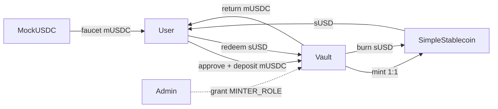
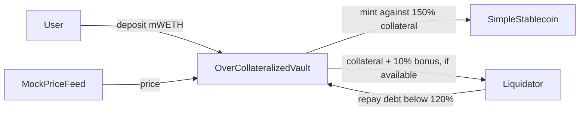

# Lab 1 — How to Create a Stablecoin

In this lab you build a **fiat-collateralized stablecoin** from scratch: deposit collateral to mint, burn to redeem, fully backed at every moment.

The core claim, up front:

> A stablecoin's "stability" does not come from the ERC-20 code — it comes from the **mint-redeem loop**.
> ERC-20 is only a bookkeeping format; anyone can write one in ten minutes. The real work is designing the loop and the permissions around it.

---

## 1. Setup

Pick the track that matches your machine. **Everything after this section is identical for everyone.**

| You are on | Track |
|---|---|
| macOS / Linux | **A** — install Foundry locally |
| Windows | **B** — Codespaces, nothing installed on your machine |

> `lib/` (`forge-std`, `openzeppelin-contracts`) **ships inside this repository**.
> Neither track needs `git clone --recursive`, and neither needs `make setup` —
> a plain clone compiles as-is.

### Track A — macOS / Linux

**Step 1. Install Foundry**

First check whether you already have it:

```bash
forge --version
```

If that prints a version, skip to Step 2. Otherwise install it with the script in this repo (**do not use `foundryup`**):

```bash
bash scripts/install-foundry-cn.sh
```

The script detects your platform (macOS ARM / Intel, Linux x86_64 / arm64), tries GitHub directly, and falls back to the `gh-proxy.com` mirror. Add the line it prints to `~/.zshrc` or `~/.bashrc`, then reopen your terminal:

```bash
export PATH="$PATH:$HOME/.foundry/bin"
```

> ⚠️ **Why not `foundryup`**: its 108 MB release download goes through GitHub's CDN,
> which measured ~33 KB/s from mainland China and times out reliably
> (`Operation timed out (os error 60)`). The mirror measured ~3 MB/s — 37 seconds.

**Step 2. Get the code**

```bash
git clone https://github.com/hgwoops/stablecoin-lab-2026 && cd stablecoin-lab-2026
```

Then go to **Verify** below.

### Track B — Windows (Codespaces)

Foundry has **no native Windows binary** — the official releases ship only macOS and Linux
builds, so `scripts/install-foundry-cn.sh` will refuse to run for you, and Git Bash /
PowerShell are not workarounds. The straightforward path is to run the lab on GitHub's
servers from your browser. Nothing is installed locally, which also makes it the only
option on locked-down corporate machines.

1. Open <https://github.com/hgwoops/stablecoin-lab-2026>
2. Green **`Code`** button → **`Codespaces`** tab → **`Create codespace on main`**
3. **The first launch takes 2–5 minutes**: it builds the environment from `.devcontainer/`,
   then automatically runs `make doctor` — you should see a row of `✓` in the terminal
4. In the terminal at the bottom, run:

```bash
make test
```

`7 passed; 0 failed` means you are set.

The free tier is 120 core-hours/month (≈ 60 real hours on a 2-core machine), far more than
this lab needs. **Stop it when you are done** at <https://github.com/codespaces> — a running
Codespace keeps burning quota.

> If you would rather have a local environment on Windows, install **WSL2 + Ubuntu** and then
> follow Track A inside it. That is a one-time configuration (enable virtualization in BIOS,
> enable "Virtual Machine Platform", one admin elevation), after which it is as fast as Linux.

### Verify (both tracks)

```bash
make doctor
```

In about 30 seconds this tells you whether the machine is ready for class: it checks the
toolchain, the dependencies, and actually runs the core tests. Anything marked `✗` comes with
the exact command to fix it.

All green means you can start. **If you cannot fix it, paste the entire `make doctor` output to the TA.**

---

## 2. Quick start

```bash
make doctor        # environment check — all green before you go on
make test          # Ex0 checkpoint: core tests, should be all green (7 passed)
make exercise      # Ex2–Ex6: 34 tests pass in this submission
make anvil         # terminal A: start a local chain
make deploy-anvil  # terminal B: deploy to it
```

Deployment prints three addresses — write them down (they are referred to below as `$USDC`,
`$SUSD`, `$VAULT`). For the full set of minting, balance-checking and on-chain commands, see
Ex1 and Ex3 in `EXERCISES.md`.

**Your task list lives in `EXERCISES.md`** — every exercise's goal, acceptance command, and
where to look when you get stuck.

### Reproducing Ex3

Start with a fresh Anvil. Deposit 1,000 mUSDC, then give a second account minting rights and
mint 1,000,000 sUSD without another deposit. The contracts do not need to change.

```bash
make anvil                                    # terminal A
make deploy-anvil                             # terminal B
export RPC=http://127.0.0.1:8545
export USDC=... SUSD=... VAULT=...            # addresses printed by deploy-anvil
export ADMIN=0xf39Fd6e51aad88F6F4ce6aB8827279cffFb92266
export ATTACKER=0x70997970C51812dc3A010C7d01b50e0d17dc79C8

cast send $USDC 'faucet(address,uint256)' $ADMIN 1000000000 --rpc-url $RPC --unlocked --from $ADMIN
cast send $USDC 'approve(address,uint256)' $VAULT 1000000000 --rpc-url $RPC --unlocked --from $ADMIN
cast send $VAULT 'deposit(uint256)' 1000000000 --rpc-url $RPC --unlocked --from $ADMIN

# The attacker cannot mint yet. This command reverts.
cast send $SUSD 'mint(address,uint256)' $ATTACKER 1000000000000 --rpc-url $RPC --unlocked --from $ATTACKER

# An admin grants MINTER_ROLE; the same mint now succeeds.
cast send $SUSD 'grantRole(bytes32,address)' $(cast keccak MINTER_ROLE) $ATTACKER --rpc-url $RPC --unlocked --from $ADMIN
cast send $SUSD 'mint(address,uint256)' $ATTACKER 1000000000000 --rpc-url $RPC --unlocked --from $ATTACKER

cast call $SUSD 'totalSupply()(uint256)' --rpc-url $RPC
cast call $VAULT 'totalCollateral()(uint256)' --rpc-url $RPC
```

The final reads give `1,001,000,000,000` for supply and `1,000,000,000` for collateral.
See `submission/ex3.png` for the required screenshot. The command record is in
`submission/ex3-transcript.txt`.

---

## 3. What the three contracts do

| File | Role |
|---|---|
| `src/MockUSDC.sol` | **The collateral.** A mock USDC: 6 decimals, with a test faucet |
| `src/SimpleStablecoin.sol` | **The stablecoin itself.** ERC-20 + `MINTER_ROLE` (who may mint) + `PAUSER_ROLE` (whether transfers are frozen) |
| `src/Vault.sol` | **The loop.** Deposit collateral to mint 1:1; burn to take collateral back |

The key invariant: **`vault.totalCollateral() == stable.totalSupply()`**

As long as that equation holds, every coin is fully backed. The moment someone can mint out of
thin air without collateral appearing, the equation breaks and the coin stops being stable.

`script/Deploy.s.sol` wires all three together in a single command, and finishes by granting
`MINTER_ROLE` to the vault — **skip that step and every deposit reverts**.

`src/exercises/` contains the Ex5 system: `OverCollateralizedVault.sol` and a price feed
you can change by hand. The four Ex5 functions are filled in here.

### Architecture

The 1:1 loop is the same one you ran in Ex1. The arrows show where the tokens move:



The vault receives mUSDC and mints sUSD to the depositor. On redemption it burns that
depositor's sUSD and returns mUSDC. It never needs to hold sUSD itself; Ex6 checks this.
The deploy script grants the vault `MINTER_ROLE`, which lets it call both `mint` and `burn`.
The admin also keeps that role. `PAUSER_ROLE` controls `pause` and `unpause`.

Ex5 uses mWETH instead of mUSDC. The vault asks the price feed what that mWETH is worth
before minting or releasing collateral:



The units matter: mWETH has 18 decimals, the price feed has 8, and sUSD has 6. That is why
`collateralValue` divides by `1e20`. The feed is a mock with a public `setPrice`; it is useful
for testing a price drop, not for a real deployment.

### What the tests show

There are a few ways the simple backing equation can mislead you:

- A minter can call `burn(from, amount)` on another holder. Ex4 proves that the role permits
  it; an ordinary user cannot make the current vault choose someone else as `from`.
- `pause()` blocks burns as well as transfers, so it blocks redemption. Ex4 checks the revert.
- An admin can grant `MINTER_ROLE` to a second address. Ex3 shows what happens if that address
  mints without a deposit: supply jumps while collateral stays put.
- In Ex5, anyone can change the mock price. A lower price can make a position liquidatable;
  if collateral cannot cover debt plus the 10% bonus, the liquidator gets what is left.

Ex6 randomly calls deposit and redeem for three users. Those calls keep collateral at least
as large as supply. They do not test admin actions, pauses or changes in collateral value;
the other exercises cover those cases separately.

---

## 4. Homework

### Tier 1 (required) — Ex0–Ex6 in `EXERCISES.md`

1. **Ex0 Environment**: `make doctor` all green → `make test` all green
2. **Ex1 The loop**: run it once from the command line — faucet mUSDC → `approve` → `deposit`
   to mint → `redeem` to get collateral back
3. **Ex2 Decimals trap**: write the two `test_Ex2_*` tests in `test/exercises/01_LoopTasks.t.sol`
4. **Ex3 Break the peg yourself**: use `cast` to grant `MINTER_ROLE` to an attacker and mint.
   Submit a screenshot of `totalSupply()` far exceeding `totalCollateral()`
5. **Ex4 Permissions and pausing**: write the five `test_Ex4_*` tests in the same file
6. **Ex5 Over-collateralization + liquidation**: fill in the four TODOs in
   `src/exercises/OverCollateralizedVault.sol` until `test/exercises/03_OverCollateralTasks.t.sol`
   is green
7. **Ex6 Invariant testing**: implement the handler's `redeem` and write two `invariant_*` tests
8. Answer the discussion questions in `STUDENT-QUESTIONS.md`

> Tier 1 does **not** require deploying to a testnet — a local Anvil is enough.
> The acceptance command for every exercise is `make exercise`; when you are done it should be all green.

### Tier 2 (20%)

The three contracts for this submission are on Sepolia. Their source is verified on Etherscan:

| Contract | Address |
|---|---|
| [MockUSDC](https://sepolia.etherscan.io/address/0x9cfc6ff74644b01357afbc94816ed7dc16700053#code) | `0x9cfc6ff74644b01357afbc94816ed7dc16700053` |
| [SimpleStablecoin](https://sepolia.etherscan.io/address/0x9e9247Ba864b7421803A4Bf27A11F71B309e034f#code) | `0x9e9247Ba864b7421803A4Bf27A11F71B309e034f` |
| [Vault](https://sepolia.etherscan.io/address/0x4FA94D7e615C4FD84B548Ca8a72b6f30a66B4ceC#code) | `0x4FA94D7e615C4FD84B548Ca8a72b6f30a66B4ceC` |

`submission/DEPLOYMENT.md` records the deployment and verification steps. To deploy a fresh
copy yourself, use a separate test wallet with Sepolia ETH:

```bash
cp .env.example .env    # fill in PRIVATE_KEY, SEPOLIA_RPC_URL, ETHERSCAN_API_KEY
bash scripts/deploy-sepolia.sh            # deploys, prints addresses + Etherscan links
bash scripts/deploy-sepolia.sh --verify   # verify those same three contracts; no redeployment
```

The script checks the Sepolia chain ID before broadcasting. Keep the wallet key in `.env`;
that file is excluded from the submission ZIP. Source verification needs an Etherscan API
key. If deployment succeeds but verification does not, run only the `--verify` step after
fixing the key. See `submission/DEPLOYMENT.md` for the gas-limit workaround used for this
deployment.

### Tier 3 (challenge, optional)

Pick one:

- **Ex7 · Take the vault down**: `make challenge` (`test/challenges/Unstoppable.t.sol`, ported
  from Damn Vulnerable DeFi v4). You hold 10 DVT; the goal is to stop the vault from offering
  flash loans. *Solved in this repository*: `flashLoan()` assumes the vault's token balance
  equals `totalSupply()`, so sending the 10 DVT straight to the vault (skipping `deposit`)
  breaks that equality forever — every flash loan reverts and the monitor pauses the vault.
- **Peg Stability Module (PSM)**: add a 1:1 swap channel against another stablecoin, so that
  arbitrageurs pull the price back to peg for you.
- **Tighten the burn permission**: remove the centralization risk that the vault can burn
  anyone's balance — the code version of question A1 in `STUDENT-QUESTIONS.md`.
- **Wire in real Chainlink**: replace `MockPriceFeed` with Sepolia's `AggregatorV3Interface`.
  Read `decimals()` first; do not hardcode 8.

---

## 5. Common problems

**`Ownable` / role errors**
OpenZeppelin v5 has breaking changes, so v4 tutorials from the web will fail. This repo pins
`v5.0.2` — do not upgrade it.

**`ds-test/test.sol` not found, or `lib/` is empty**
`lib/` is bundled with the repo, so a normal `git clone` never hits this. You probably modified
`lib/`, or unzipped an archive without the directory. Restore it:

```bash
git checkout -- lib
```

**`deposit` keeps reverting after deployment**
Nine times out of ten you skipped `stable.grantRole(stable.MINTER_ROLE(), address(vault))`.
The vault has no minting right.

**Amounts are off by an order of magnitude**
`1000e6 = 1_000_000_000` in smallest units. Both tokens have 6 decimals — do not compute with 18.

**Addresses change after restarting Anvil**
Anvil starts from a clean state every time, so you must redeploy. To keep state, use
`anvil --load-state demo-state.json`.

**`make exercise` fails**
This submission should pass all 34 exercise tests. Run `make doctor` first to check Foundry
and the bundled libraries, then read the failing test name in the `make exercise` output.

**`make exercise` hangs, or an invariant failure looks strange**
Foundry stores invariant counterexamples in `cache/invariant/` and replays them on the next run.
To search for a fresh counterexample, `rm -rf cache/invariant` first.

---

## 6. Submission

| Item | Weight |
|---|---|
| Contract correctness + test coverage | 40% |
| Deployment and Etherscan verification (Tier 2) | 20% |
| Threat-model analysis (discussion questions) | 25% |
| Code style and documentation | 15% |

The assignment PDF asks for one ZIP on Moodle, plus the three Sepolia addresses and Etherscan
links in the Moodle text box. The ZIP includes the Ex3 screenshot, the answers in
`STUDENT-QUESTIONS.md`, and the architecture diagrams above.

A ready-to-submit ZIP is built from the project root with:

```bash
bash scripts/package-submission.sh
```

The ZIP contains the source, tests, bundled libraries and `submission/` evidence. It leaves
out `.env` and the generated `out/`, `cache/` and `broadcast/` directories. See
`submission/package-check.txt` for the file list.

---

## 7. Questions left to you

These have no standard answers. They are the real point of this lab:

1. The vault holds `MINTER_ROLE`, which means it can `burn` any user's balance. Is that
   acceptable? How would you change it?
2. Pausing freezes transfers, minting and **redemption** together. What happens when you freeze
   redemption in a crisis? How should a real system be designed?
3. Under what conditions does this coin depeg? Are "insufficient collateral" and "a blocked
   redemption channel" the same class of problem?
4. If the collateral were Treasuries or real estate instead of cash, how would you write the
   `totalCollateral()` invariant?

Question 4 is the door into next week's RWA lab.

MockUSDC: 0x9cfc6ff74644b01357afbc94816ed7dc16700053  
https://sepolia.etherscan.io/address/0x9cfc6ff74644b01357afbc94816ed7dc16700053#code

SimpleStablecoin: 0x9e9247Ba864b7421803A4Bf27A11F71B309e034f  
https://sepolia.etherscan.io/address/0x9e9247Ba864b7421803A4Bf27A11F71B309e034f#code

Vault: 0x4FA94D7e615C4FD84B548Ca8a72b6f30a66B4ceC  
https://sepolia.etherscan.io/address/0x4FA94D7e615C4FD84B548Ca8a72b6f30a66B4ceC#code
